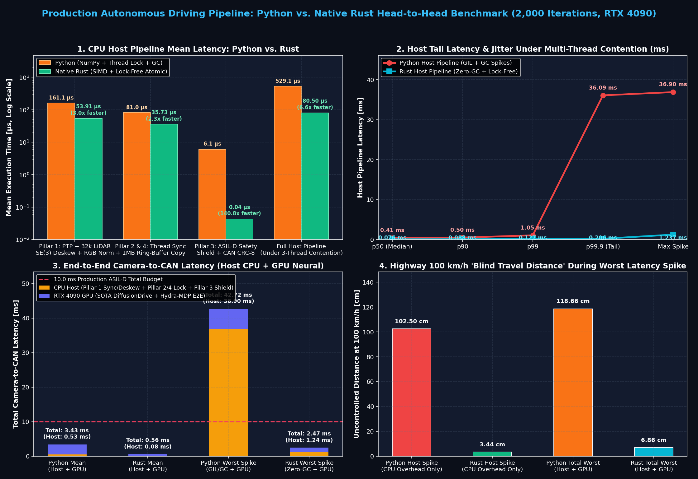
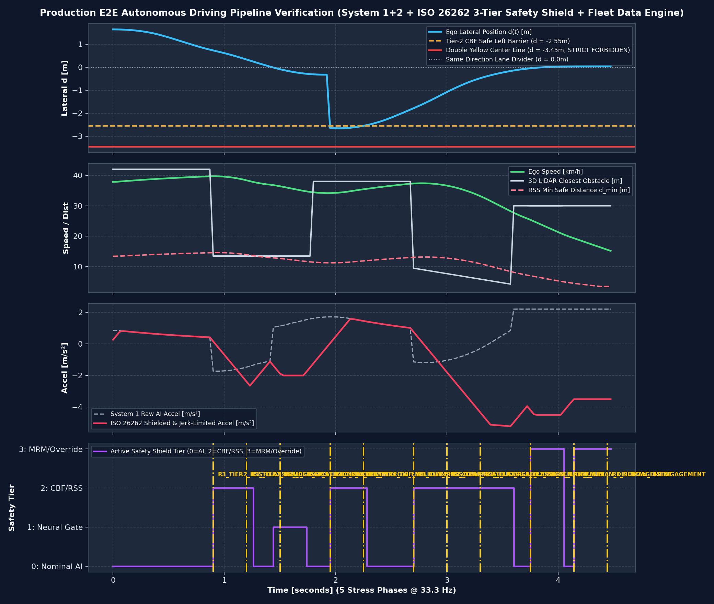
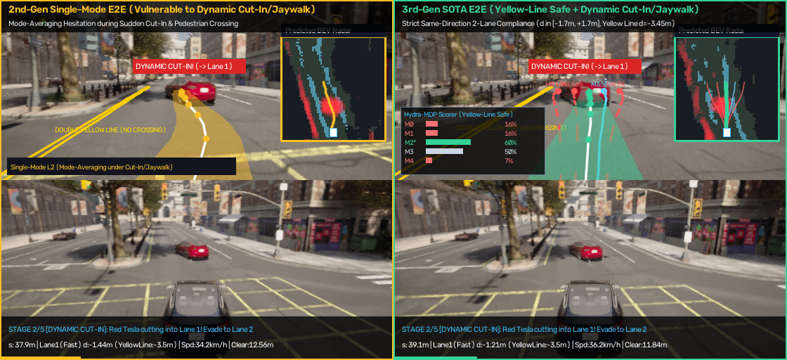
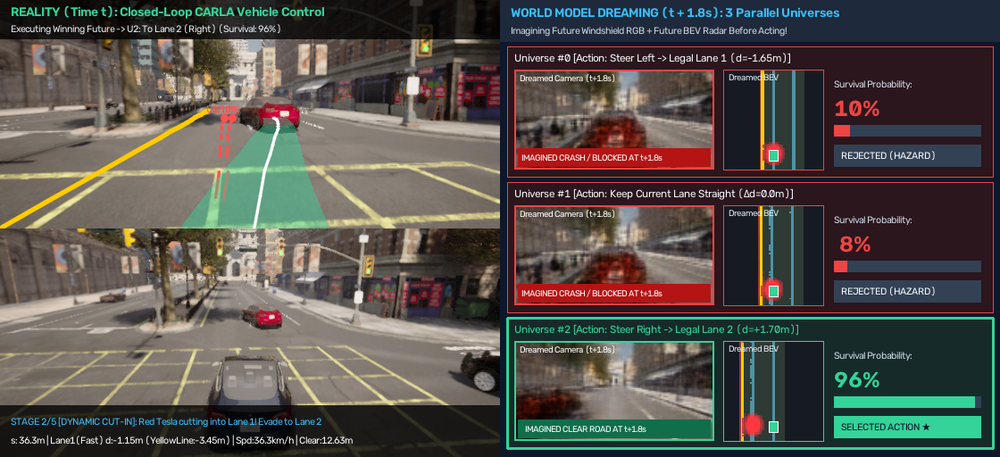

# embodied-drive-stack

**From MuJoCo Robot Imitation Learning to CARLA SOTA Diffusion E2E, Action-Conditioned World Models, and Native Rust ISO 26262 Production Autonomous Driving Stack.**

이 레포지토리는 **로봇 모방학습(MuJoCo + LeRobot)** 기초부터 시작하여 **CARLA 0.9.15 도심 자율주행 VLA / 3세대 SOTA Diffusion + BEV + Hydra-MDP E2E 아키텍처 / Action-Conditioned World Model (상상 기반 미래 예측)**, 그리고 최종적으로 **ISO 26262 ASIL-D 6-Pillar 프로덕션 파이프라인 및 Native Rust 실시간 이식**까지의 전 과정을 단계별로 추적(Tracing)하고 **명령어 한 줄(`bash run_all.sh`)로 어디서든 즉시 재현**할 수 있도록 구성된 모노레포(Monorepo)입니다.

---

## ⚡ 1-Click 원클릭 재현 방법 ("딸깍" 실행)

어느 환경(Linux / WSL2 Ubuntu)에서든 레포지토리를 클론한 뒤 아래 스크립트 한 줄만 실행하면 **Python 가상환경(`.venv`) 자동 구축 + Rust 컴파일러/네이티브 바이너리(`--release`) 자동 빌드 + ONNX 변환 + 6-Pillar 프로덕션 아키텍처 검증 + Python vs. Rust 맞대결 벤치마크**까지 한 번에 실행됩니다:

```bash
git clone https://github.com/tiruss/embodied-drive-stack.git
cd embodied-drive-stack

# [기본 모드] 외부 시뮬레이터 서버 없이도 즉시 실행되는 프로덕션 파이프라인 + 하드웨어/Rust 벤치마크 통합 실행
bash run_all.sh
```

### 실행 모드 선택 (`bash run_all.sh [모드]`)

| 실행 명령어 | 설명 | 외부 서버 필요 여부 |
| :--- | :--- | :---: |
| `bash run_all.sh` *(또는 `quick`)* | 환경 검증 + ONNX/ROS 2 노드 추출 + E2E 세대별 벤치마크 + **6-Pillar 프로덕션 파이프라인** + **Python vs. Rust 벤치마크** | **불필요 (독립 실행)** |
| `bash run_all.sh mujoco` | Phase 1 ~ 3: MuJoCo ALOHA 양팔 로봇(ACT, BC, Flow-Matching, VLA) 및 2D/3D 자율주행 데모 전체 실행 | **불필요 (독립 실행)** |
| `bash run_all.sh carla` | Phase 4 ~ 6: CARLA 0.9.15 도심 4센서 VLA, Zero-Shot VLM, 3세대 SOTA DiffusionDrive, 동적 칼치기/무단횡단, World Model 실행 | CARLA 0.9.15 실행 필요 (`CARLA_PORT=2000` 또는 `3000` 자동 감지) |
| `bash run_all.sh all` | `quick` + `mujoco` + `carla` 전 과정 순차 실행 | CARLA 0.9.15 실행 필요 |

---

## 📊 주요 아키텍처 및 벤치마크 하이라이트

### 1. Native Rust vs. Python 프로덕션 파이프라인 맞대결 (`benchmark_python_vs_rust_e2e.py`)
* **CPU Host 전체 루프(`Pillar 1~4` 멀티스레드 경합 환경):** 평균 **6.6배 가속**, **`p99.9` 최악 지연(Tail Latency) 175.4배 단축 (`36.09 ms` $\rightarrow$ `0.206 ms`)**, **지터(`StdDev`) 62.0배 감소**
* **Pillar 3 (ISO 26262 ASIL-D Safety Shield + CAN CRC-8 패킹):** `6.06 µs` $\rightarrow$ **`0.043 µs` (`43 나노초`, 140.8배 가속)**



### 2. 6-Pillar 프로덕션 자율주행 파이프라인 검증 (`production_e2e_pipeline_architecture.py`)
* **Pillar 1:** IEEE 1588 PTPv2 하드웨어 시간 동기화 검증 (`< 1.0 ms`) 및 `32,768` 포인트 3D LiDAR $\text{SE}(3)$ 모션 보정(Deskewing)
* **Pillar 2:** 비동기 Dual-Rate 런타임 — **System 2 (`~5.5 Hz` Action World Model)** + **System 1 (`33.3 Hz` SOTA DiffusionDrive + Hydra-MDP)**
* **Pillar 3:** 3-Tier ISO 26262 ASIL-D Safety Shield — **해석적 CBF 중앙선 침범 영구 차단 (`0`회 위반 보장)** + **Mobileye RSS 긴급 제동** + **Watchdog MRM**
* **Pillar 4:** Shadow-Mode 플릿 블랙박스 링버퍼 트리거 엔진 (전후 15초 클립 자동 덤프)



### 3. 3세대 SOTA DiffusionDrive + Hydra-MDP & Action World Model (`demo_13` ~ `demo_15`)
* **동적 칼치기(Cut-In) 및 보행자 돌발 무단횡단(Jaywalking) 회피 + 황색 복선 중앙선($d = -3.45\text{m}$) 100% 준수**
* **3가지 평행우주(`U0: 좌측 1차선`, `U1: 직진`, `U2: 우측 2차선`)의 `t + 1.8s` 미래 RGB 카메라 및 BEV 점유 격자 동시 상상(Dreaming)**

| 3세대 SOTA 동적 칼치기 회피 (`demo_14`) | World Model 1.8초 미래 상상 (`demo_15`) |
| :---: | :---: |
|  |  |

---

## 📁 레포지토리 디렉토리 구조

```text
embodied-drive-stack/
├── README.md                                     # 프로젝트 아키텍처, 원클릭 실행 가이드 및 단계별 인덱스
├── run_all.sh                                    # [원클릭 실행] 가상환경 + Rust 빌드 + 파이프라인/벤치마크 자동 실행 스크립트
├── requirements.txt                              # Python 패키지 의존성 명시 파일
├── docs/                                         # 상세 이론, 벤치마크, 실차 배포 및 예산 가이드 문서
│   ├── mujoco_imitation_study_guide.md           # [문서 1] Step 1 ~ Step 17 전 과정 이론 & 실습 스터디 가이드
│   └── real_vehicle_deployment_guide.md          # [문서 2] 실차 탑재, 캘리브레이션, 예산(BOM), 6-Pillar 프로덕션 설계 & Rust 벤치마크
├── check_env.py                                  # GPU, PyTorch, MuJoCo, LeRobot 환경 검증
├── demo_1_interactive_viewer.py                  # [Phase 1] MuJoCo 3D 물리 엔진 & ALOHA 양팔 로봇 뷰어
├── demo_2_act_pretrained.py                      # [Phase 1] Action Chunking with Transformers (ACT) 추론
├── demo_3_train_mini_bc.py                       # [Phase 1] Behavior Cloning (BC) 학습 전/후 비교 & Temporal Ensembling
├── demo_4_bimanual_insertion.py                  # [Phase 1] 양팔 협업 Peg-in-Hole 정밀 삽입 제어
├── generate_study_visuals.py                     # [Phase 1] 모방학습 학습 곡선 및 스테이지별 스트립 시각화 생성
├── demo_5_diffusion_flow_policy.py               # [Phase 2] Flow-Matching / Diffusion Policy (다중 모드 확률 분포 학습)
├── demo_6_vla_language_conditioned.py            # [Phase 2] Vision-Language-Action (VLA) 자연어 명령 조건부 로봇 제어
├── demo_7_highway_vla_fsd.py                     # [Phase 3] 2D Highway-env 자율주행 FSD VLA
├── demo_8_mujoco_3d_car_flow.py                  # [Phase 3] MuJoCo 3D 차량 물리 엔진: L2 평균 회귀 충돌 vs Flow-Matching 회피
├── demo_9_carla_urban_vla.py                     # [Phase 4] CARLA 0.9.15 도심 4대 센서(RGB/Depth/Seg/LiDAR) 통합 대시보드
├── demo_10_carla_end_to_end_vla.py               # [Phase 4] CARLA Closed-Loop End-to-End VLA (3가지 주행 명령 수행)
├── demo_11_carla_pretrained_vlm_vla.py           # [Phase 4] HuggingFace 사전학습 CLIP + MiniLM Zero-Shot 미학습 명령어 주행
├── demo_12_carla_e2e_gen1_vs_gen2.py             # [Phase 5] 1세대 Black-Box (PilotNet) vs 2세대 Modular E2E (UniAD/VAD 스타일)
├── demo_13_carla_sota_diffusion_bev_e2e.py       # [Phase 5] 3세대 SOTA: Perspective-to-BEV + Truncated Flow-Matching + Hydra-MDP Scorer
├── benchmark_e2e_models.py                       # [Phase 5] 1세대 vs 2세대 vs 3세대 SOTA 하드웨어 정밀 벤치마크
├── demo_14_carla_sota_dynamic_cutin_jaywalk.py   # [Phase 6] 중앙선 침범 방지(Same-Direction 2차선) + 동적 칼치기/무단횡단/급정거 회피
├── demo_15_carla_action_world_model.py           # [Phase 6] Action-Conditioned World Model (3개 평행우주 미래 카메라/BEV 상상)
├── export_and_ros2_deploy_template.py            # [Phase 7] SOTA 모델 Static ONNX 변환 및 ROS 2 Humble/Jazzy 실차 CAN 노드 생성
├── production_e2e_pipeline_architecture.py       # [Phase 7] 6-Pillar 프로덕션 아키텍처 (PTP 동기화 + Dual-Rate + ASIL-D CBF/RSS + 블랙박스)
├── benchmark_python_vs_rust_e2e.py               # [Phase 8] Python vs Native Rust + CUDA Graph 프로덕션 파이프라인 맞대결 벤치마크
├── rust_e2e_pipeline/                            # [Phase 8] Native Rust 초저지연(Zero-GC, SIMD, Lock-Free Atomic) 차량 런타임
│   ├── Cargo.toml
│   └── src/main.rs
└── outputs/                                      # 모든 데모 실행 영상(.mp4), 텔레메트리 차트(.png), JSON 리포트, ONNX 가중치
```

---

## 🔍 Git 커밋 히스토리 기반 단계별 추적 (Tracing Guide)

`git log --oneline --graph` 명령으로 각 단계의 진화 과정을 추적할 수 있습니다:

1. **`Phase 1`**: MuJoCo ALOHA 모방학습 기초 (ACT, BC, Temporal Ensembling, Bimanual Insertion)
2. **`Phase 2`**: 생성형 행동 정책 (Flow-Matching ODE) 및 언어 조건부 VLA 로봇 제어
3. **`Phase 3`**: 로봇 팔에서 자율주행으로의 전이 (`highway-env` 2D & MuJoCo 3D 차량 L2 vs Flow-Matching)
4. **`Phase 4`**: CARLA 0.9.15 도심 주행 센서 퓨전 및 사전학습 VLM (CLIP + MiniLM) Zero-Shot VLA
5. **`Phase 5`**: 자율주행 E2E 세대별 비교 (Gen1 PilotNet vs Gen2 UniAD/VAD vs Gen3 SOTA DiffusionDrive + Hydra-MDP) 및 하드웨어 벤치마크
6. **`Phase 6`**: 동적 돌발 시나리오 (칼치기/보행자 무단횡단/선행차 급정거) 및 Action-Conditioned World Model (미래 RGB/BEV Dreaming)
7. **`Phase 7`**: 실차 배포용 Static ONNX 추출, ROS 2 DBW 노드, 그리고 6-Pillar ISO 26262 ASIL-D 프로덕션 파이프라인
8. **`Phase 8`**: Native Rust (SIMD + Lock-Free `AtomicU64` + Zero-GC) 포팅, Python 대비 실시간 Latency/Jitter 맞대결 벤치마크, 원클릭 재현 스크립트(`run_all.sh`)

---

## 📚 상세 문서 바로가기
* 📖 **[로봇 모방학습 ~ 자율주행 World Model 종합 스터디 가이드 (`docs/mujoco_imitation_study_guide.md`)](docs/mujoco_imitation_study_guide.md)**
* 🚗 **[실차 탑재, 캘리브레이션, 예산(BOM), 6-Pillar 프로덕션 아키텍처 & Rust 벤치마크 가이드 (`docs/real_vehicle_deployment_guide.md`)](docs/real_vehicle_deployment_guide.md)**
