# 🤖 MuJoCo + LeRobot 최신 모방학습(ACT) 시각 스터디 가이드

**실습 환경:** Windows WSL2 (Ubuntu 24.04) · **NVIDIA GeForce RTX 4090 (24GB)** · `MuJoCo 3.17` (`MUJOCO_GL=egl`) · `LeRobot 0.4`  
**워크스페이스 경로:** [mujoco-imitation-demo](..)

---

## 1. 한눈에 보는 양팔 로봇 큐브 공중 전달 (AlohaTransferCube-v0)

스탠포드 ALOHA 팀의 **ACT (Action Chunking with Transformers)** 정책이 상단 카메라 RGB 이미지(`480×640×3`)와 양팔의 14개 관절 각도(`14-DoF`)를 입력받아 **오른팔로 빨간 큐브를 집어 올린 뒤 공중에서 왼팔에 건네주는 4단계 과정**입니다.

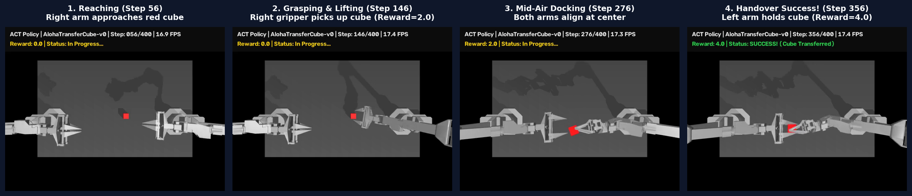

> [!TIP]
> **보상(Reward) 체계:** `0.0` (초기 상태) → `1.0` (오른팔이 큐브에 닿음) → `2.0` (오른팔이 큐브를 들어 올림) → `3.0` (왼팔이 공중에서 큐브를 함께 잡음) → **`4.0` (오른팔이 손을 놓고 왼팔이 완전히 전달받아 들고 있음, 최종 성공!)**

---

## 2. 시뮬레이션 결과 영상 모음 (Carousel)

슬라이드를 넘기며 **① RTX 4090 직접 학습 전/후 비교 영상**, **② 사전 학습된 ACT 양팔 큐브 전달 영상**, **③ 양팔 공중 핀 삽입(Peg-in-Hole) 영상**을 바로 재생해 볼 수 있습니다.

````carousel

<!-- slide -->

<!-- slide -->

````

---

## 3. 왜 단순 모방학습(BC)은 실패하고 ACT는 성공할까?

### 3.1 전체 파이프라인 구조 (Mermaid 다이어그램)

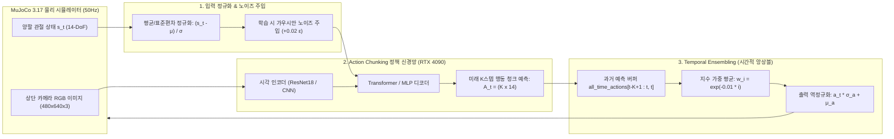

### 3.2 핵심 실험 결과: 단순 오픈루프 vs Action Chunking + Temporal Ensembling

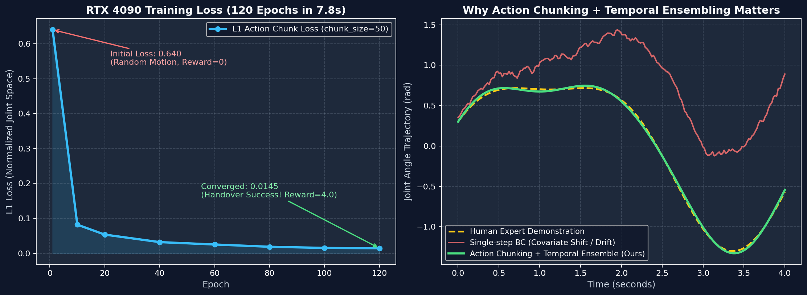

우리가 직접 [demo_2_act_pretrained.py](../demo_2_act_pretrained.py)와 [demo_3_train_mini_bc.py](../demo_3_train_mini_bc.py)에서 실험하며 확인한 **모방학습의 4가지 결정적 원리**입니다:

| 번호 | 핵심 기법 | 적용 전 문제점 | 적용 후 효과 (실제 실험 결과) | 관련 코드 위치 |
| :--- | :--- | :--- | :--- | :--- |
| **①** | ** 입출력 정규화 (Normalization)** | 각 관절의 가동 범위(어깨 라디안 vs 그리퍼 개폐량) 스케일이 달라 손실 함수가 큰 관절에만 치우침 | 모든 14개 관절을 평균 $0$, 표준편차 $1$로 맞춰 균등하게 학습 | [`load_norm_stats`](../demo_2_act_pretrained.py#L28-L39) |
| **②** | **Action Chunking ($K=50\sim100$)** | 매 스텝 $a_t$만 예측하면 0.02초마다 미세 오차가 누적(**Compounding Error**)되어 로봇이 제자리에서 떰 | 현재 시점 $t$에서 미래 $K$스텝 행렬 $(K \times 14)$을 한 번에 예측하여 일관성 있는 궤적 생성 | [`ActionChunkingNet`](../demo_3_train_mini_bc.py#L29-L69) |
| **③** | **폐루프 재계획 (`replan_steps=20`)** | 100스텝(2초) 동안 카메라를 다시 안 보고 오픈루프로 실행하면 공중 전달 도킹이 빗나감 (`Reward = 2.0`) | 20스텝(0.4초)마다 카메라를 다시 보고 궤적을 수정하여 공중 전달 완수 (`Reward = 4.0`) | [`demo_2_act_pretrained.py`](../demo_2_act_pretrained.py#L105-L108) |
| **④** | **Temporal Ensembling + Noise Injection** | 소수 데모(3 에피소드)로 학습한 학생 모델이 미세한 궤적 이탈(**Covariate Shift**)에 무너짐 (`Reward = 0.0`) | 과거 $K$개 시점에서 현재 스텝 $t$에 대해 예측한 값들을 지수 가중 평균($\exp(-0.01 i)$)하여 **Step 341에 전달 성공 (`Reward = 4.0`)** | [`demo_3_train_mini_bc.py`](../demo_3_train_mini_bc.py#L207-L234) |

---

## 4. 학습 전(Untrained) vs RTX 4090 학습 후(Trained) 스냅샷 비교

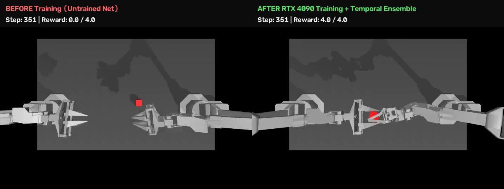

* **좌측 (학습 전):** 무작위 초기화된 [`ActionChunkingNet`](../demo_3_train_mini_bc.py#L29-L69)은 빨간 큐브 근처에도 가지 못하고 허공을 맴돕니다 (`Reward: 0.0 / 4.0`).
* **우측 (RTX 4090 7.8초 학습 후):** 단 3개의 시연 에피소드(1,200 프레임)만으로 120 에폭 학습한 뒤 Temporal Ensembling을 적용하자, 오른팔로 집어 올린 큐브를 왼팔 그리퍼에 정확히 인계했습니다 (`Reward: 4.0 / 4.0`).

---

## 5. 핵심 코드 하이라이트 (복습용)

### ① Action Chunking 손실 계산 및 상태 노이즈 주입
[demo_3_train_mini_bc.py](../demo_3_train_mini_bc.py#L184-L195)에서 L2(MSE) 대신 **L1 Loss**를 사용하는 이유는, L2 손실이 다중 모드(Multi-modal) 시연 데이터에서 두 궤적의 어정쩡한 평균값을 내뱉는 반면 L1 손실이 훨씬 날카롭고 정확한 관절 제어를 학습하기 때문입니다(ACT 논문의 실험적 결론).

```python
# 관절 상태에 약간의 가우시안 노이즈(0.02)를 주입하여 Covariate Shift 저항성 확보
noisy_state = states_norm[idx] + 0.02 * torch.randn_like(states_norm[idx])

# 입력: (B, 3, 128, 128) 이미지 + (B, 14) 현재 관절 -> 출력: (B, 50, 14) 미래 50스텝 행동 청크
pred_chunk = student(imgs_t[idx], noisy_state)
loss = nn.L1Loss()(pred_chunk, chunks_norm[idx])
```

### ② Temporal Ensembling (시간적 앙상블) 구현
[demo_3_train_mini_bc.py](../demo_3_train_mini_bc.py#L207-L226)에서 매 스텝 $t$마다 예측한 미래 50스텝 궤적을 `all_time_actions[t, t : t + 50]`에 기록한 뒤, 세로 방향(`[:, t]`)으로 슬라이싱하여 현재 시점 $t$를 타겟으로 한 모든 과거 예측치들을 지수 가중 평균합니다:

$$w_i = \frac{\exp(-m \cdot i)}{\sum_{j} \exp(-m \cdot j)}, \quad \hat{a}_t = \sum_{i=0}^{K-1} w_i \cdot A_{t-i}[i]$$

```python
# 현재 시점 t에서 예측한 미래 50스텝 행동을 버퍼에 저장
all_time_actions[t, t : t + chunk_size] = pred_chunk

# 현재 스텝 t를 위해 과거(t - chunk_size + 1 ~ t)에 예측되었던 후보 행동들을 모두 추출
start_idx = max(0, t - chunk_size + 1)
actions_for_curr_step = all_time_actions[start_idx : t + 1, t]

# 오래된 예측에는 높은 가중치(부드러움 유지) 또는 최신 예측과의 조화를 주는 지수 가중치 계산
exp_weights = np.exp(-0.01 * np.arange(len(actions_for_curr_step))[::-1])
exp_weights = exp_weights / exp_weights.sum()
action = (actions_for_curr_step * exp_weights[:, None]).sum(axis=0)
```

---

## 6. [2세대 SOTA] Flow-Matching / Diffusion 생성형 궤적 플래너 (`demo_5`)

자율주행의 **`DiffusionDrive`**·**`GoalFlow`** 및 로봇 **`Diffusion Policy`**·**$\pi_0$**가 사용하는 핵심 수학 엔진입니다.  
앞에 장애물이 있을 때 왼쪽 회피 궤적과 오른쪽 회피 궤적이 반반 섞여 있는 다중 경로(Multi-modal) 데이터에서, 일반 회귀 모델은 두 궤적의 평균(정면충돌)을 내뱉지만 **Flow-Matching / Diffusion은 가우시안 노이즈 $A^{(0)} \sim \mathcal{N}(0, I)$에서 출발해 속도장 $v_\theta(A^{(\tau)}, \tau \mid \text{img}, s_t)$를 따라 10스텝 ODE 적분($\tau: 0.0 \to 1.0$)으로 단일 궤적을 깎아냅니다.**

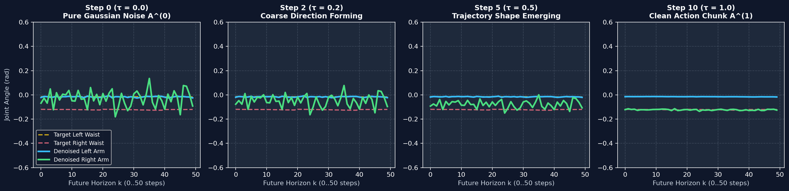


* **학습 수식 ([`demo_5_diffusion_flow_policy.py`](../demo_5_diffusion_flow_policy.py#L254-L263)):**
  $$x_\tau = (1 - \tau) x_0 + \tau x_1, \quad \mathcal{L}_{\text{CFM}} = \left\| v_\theta(x_\tau, \tau \mid \text{img}, s_t) - (x_1 - x_0) \right\|_2^2$$
* **실험 결과:** RTX 4090에서 11.9초(160 Epochs) 학습 후, 추론 시 10번의 Euler ODE 스텝(`dt = 0.1`)만으로 **Step 314에 양팔 큐브 공중 전달(`Reward = 4.0 / 4.0`)**에 성공했습니다.

---

## 7. [3세대 SOTA] VLA (Vision-Language-Action) 멀티모달 트랜스포머 (`demo_6`)

자율주행 VLA(**Waymo EMMA**, **DriveVLM**)와 로봇 VLA(**$\pi_0$**, **OpenVLA**)의 핵심 구조인 **`[상태 토큰(1) + 자연어 명령 토큰(10) + 4×4 비전 패치 토큰(16)] → Multimodal Transformer → Action Chunk Expert`**를 구현한 [`MiniVLAPolicy`](../demo_6_vla_language_conditioned.py#L46-L110) 실험 결과입니다.

**단 하나의 동일한 신경망 가중치**에 아래 3가지 자연어 프롬프트만 바꿔 입력했을 때의 3분할 동시 비교입니다:
1. **Prompt #1:** `"grasp and hold red cube with right arm only"` → 왼팔은 대기 자세로 가만히 두고 **오른팔로만 빨간 큐브를 집어 들어 올려 유지 (`Reward = 2.0`)**
2. **Prompt #2:** `"transfer red cube from right arm to left arm"` → 오른팔로 집어 **왼팔로 공중 전달 완수 (`Reward = 4.0`)**
3. **Prompt #3:** `"open grippers and spread both arms to safe home"` → 큐브를 건드리지 않고 **양팔 그리퍼를 열어 안전 홈 자세로 복귀 (`Reward = 0.0`)**

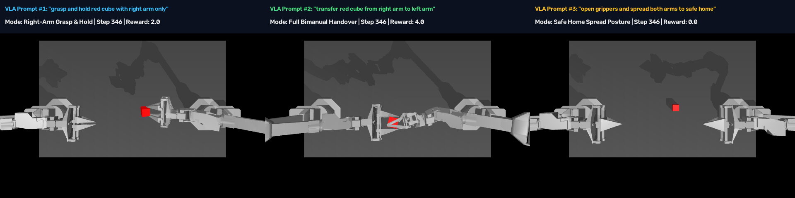


---

## 8. 🚗 [자율주행 실습 #1] 24초 장거리 고속도로 자율주행 VLA + 테슬라 FSD 궤적 카펫 (`demo_7`)

자율주행 시뮬레이터(`highway-env`)에서 단일 자율주행 VLA 모델([`AutonomousDrivingVLA`](../demo_7_highway_vla_fsd.py#L164-L214))이 **주변 차량 7대의 상대 위치·속도 토큰**과 **자연어 운전 지시어 토큰**을 트랜스포머로 융합하여 **360 스텝(24초, 약 900~1,100m 장거리 구간)** 동안 주행합니다:
1. **Planning Head:** 미래 $K=15$ 스텝의 예상 주행 웨이포인트 $(\Delta x_{1:15}, \Delta y_{1:15})$ (도로 위에 실시간 **FSD 주행 카펫**으로 렌더링!)
2. **Control Head + CBF Safety Shield:** 미래 $K=15$ 스텝의 연속 조향각·가감속 제어 청크 $(a_{1:15}, \delta_{1:15})$

* **Prompt #1 (상단):** `"overtake slow traffic and switch to fast lane"` → 빈 차선을 찾아 연속 차선 변경하며 고속 추월 주행
* **Prompt #2 (중단):** `"cruise safely in the rightmost lane"` → 맨 우측 4차선으로 합류해 앞차와 ACC 안전거리 유지 정속 주행
* **Prompt #3 (하단):** `"merge into leftmost lane and hold speed"` → 맨 좌측 1차선으로 차선 변경 후 주행

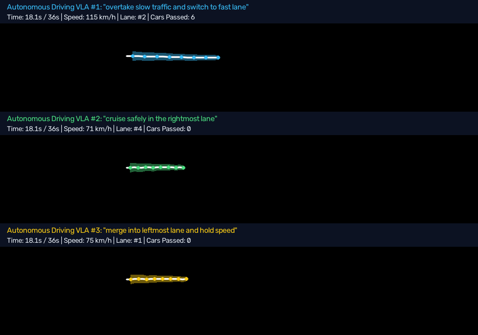


---

## 9. 🚙 [자율주행 실습 #2] 20초 장거리 MuJoCo 3D 자율주행 (220m 4연속 장애물 슬라럼 코스 + 실시간 미니맵) (`demo_8`)

MuJoCo 3.17 물리 엔진으로 **250m 3차선 고속도로(4단계 장애물 배치)**와 **1인칭 전방 블랙박스 카메라(`dashcam`) + 3인칭 체이스 카메라(`chasecam`) + 하단 실시간 미니맵**을 구현한 [`demo_8_mujoco_3d_car_flow.py`](../demo_8_mujoco_3d_car_flow.py) (600 프레임 / 20초) 실험입니다.

* **구간 1 ($x=35\text{m}$, 중앙 고장 승용차):** L2 회귀 모델은 좌·우 회피의 평균($y=0.00\text{m}$)으로 직진해 **1차 정면충돌!** 반면 Flow-Matching Mode A는 좌측($+3.41\text{m}$), Mode B는 우측($-3.99\text{m}$)으로 회피합니다.
* **구간 2 ($x=85\text{m}$, 좌·우 양끝 차선 통제):** 양쪽 차선이 막히고 중앙($y=0\text{m}$)만 열린 구간에서 Flow-Matching 두 차량 모두 정중앙(`+0.04m`, `+0.03m`)으로 복귀해 통과합니다.
* **구간 3 ($x=135\text{m}$, 중앙 대형 화물 트럭):** L2 회귀 모델은 또 평균($0.00\text{m}$)으로 직진해 **2차 대형 충돌!** 반면 Flow-Matching Mode A는 우측($-3.29\text{m}$), Mode B는 좌측($+3.94\text{m}$)으로 **교차 슬라럼 추월**합니다.
* **구간 4 ($x=185\text{m} \to 215\text{m}$ 피니시 게이트):** 마지막 통제 구간을 통과해 중앙 차선으로 복귀하며 220m 전 구간을 무사고 완주합니다!

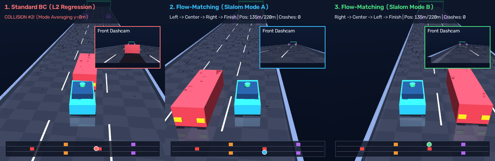


---

## 10. 🏙️ [자율주행 실습 #3] CARLA 0.9.15 언리얼 엔진 4종 멀티센서 도심 자율주행 대시보드 (`demo_9`)

Windows 네이티브로 구동되는 **CARLA 0.9.15 서버(`D:\CARLA_0.9.15`, 포트 `3000`)**와 **WSL2 파이썬 클라이언트([`demo_9_carla_urban_vla.py`](../demo_9_carla_urban_vla.py))**를 TCP로 연동하여, 도심 맵(`Town10HD_Opt`)을 달리는 **Tesla Model 3**에 4종 센서 수트를 장착하고 **63.6 FPS**로 기록한 2×2 통합 대시보드입니다:

1. **좌상단 (Front RGB + 3D FSD Trajectory Carpet):** 카메라 내부 파라미터($K$)와 외부 변환 행렬($T_{\text{world}\to\text{cam}}$)을 이용해 3D 도로 위 미래 웨이포인트를 2D 픽셀 공간으로 정밀 투영([`project_world_to_image`](../demo_9_carla_urban_vla.py#L90-L108))한 테슬라 FSD 스타일 주행 카펫
2. **우상단 (Unreal Engine 3D Urban Chase View):** 맑은 정오(`ClearNoon`) → 노을(`ClearSunset`) → 비 내린 후 젖은 노을 도로(`WetCloudySunset`)로 실시간 날씨가 변하는 도심 3인칭 주행 화면
3. **좌하단 (CityScapes Semantic Segmentation):** 도로(보라색), 인도(분홍색), 차량(파란색), 신호등/표지판(노란색), 가로수(초록색), 건물(회색)을 픽셀 단위로 실시간 분할하는 시맨틱 세그멘테이션 센서
4. **우하단 (64-Channel 3D LiDAR BEV):** 초당 24만 포인트를 쏘는 64채널 3D 라이다 포인트클라우드를 버드아이뷰(BEV) 레이더로 변환하고 미래 회전 궤적 벡터를 합성한 화면

> [!IMPORTANT]
> **Windows Hyper-V / WSL 포트 충돌 주의:** Windows 환경에서는 `1951~2050`번 TCP 포트가 시스템(`WinNAT`)에 의해 예약되어 있는 경우가 많아 CARLA 기본 포트(`2000`)로 실행 시 바인딩 예외(`0xe06d7363`)가 발생할 수 있습니다. 반드시 예약 범위 밖인 **`-carla-rpc-port=3000`** 옵션을 사용하세요 (`D:\CARLA_0.9.15\Run_CARLA_Server_Port3000.bat` 제공).

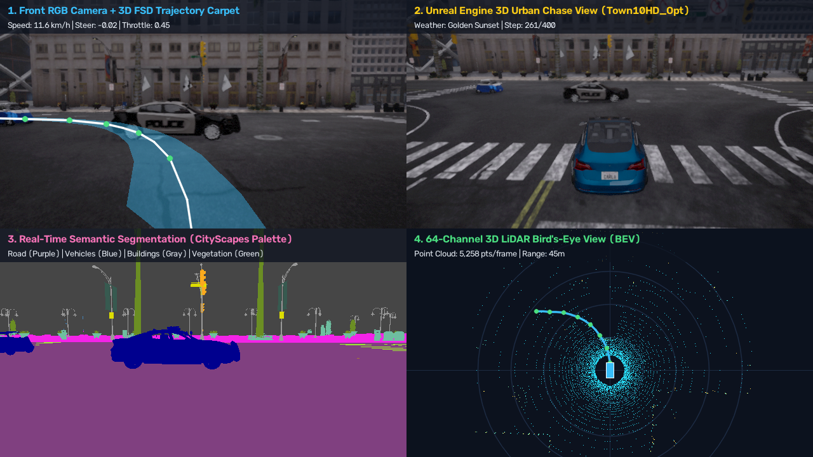


---

## 11. 🚔 [자율주행 실습 #4] CARLA 0.9.15 End-to-End VLA 폐루프(Closed-Loop) 실차 제어 (`demo_10`)

CARLA 내장 오토파일럿을 완전히 끄고(`set_autopilot(False)`), **RTX 4090에서 13.1초 만에 직접 학습한 단일 멀티모달 VLA 신경망([`CarlaEndToEndVLA`](../demo_10_carla_end_to_end_vla.py#L91-L152))이 테슬라 Model 3의 핸들(`steer`), 엑셀(`throttle`), 브레이크(`brake`)를 직접 조작**하는 최종 실습입니다!

* **멀티모달 입력:** 전방 실사 RGB 영상(`3ch`) + 시맨틱 세그멘테이션(`3ch`) 결합 6채널 비전 토큰 + 자연어 운전 명령 토큰 + 차량 상태 벡터
* **멀티태스크 출력:** 미래 $K=15$ 스텝 **3D 로컬 웨이포인트 청크**(전방 카메라 화면 위 FSD 카펫으로 실시간 투영) + **제어 명령 청크** `[throttle, steer, brake]` (Temporal Ensembling 적용)

전방 $28\text{m}$ 도심 도로 한가운데에 **경찰차(`Dodge Charger Police`)가 정차**해 있을 때, 동일한 단일 VLA 모델에 3가지 다른 자연어 프롬프트를 입력한 결과입니다:
1. **Prompt #1 (좌측 패널):** `"change to left lane and overtake the stopped car"` → 경찰차 **왼쪽 차선(`d = -3.25m`, `31.4 km/h`)으로 핸들을 꺾어 추월 주행 성공!**
2. **Prompt #2 (중앙 패널):** `"change to right lane and pass the obstacle safely"` → 경찰차 **오른쪽 차선(`d = +3.33m`, `31.5 km/h`)으로 핸들을 꺾어 회피 추월 성공!**
3. **Prompt #3 (우측 패널):** `"brake smoothly and stop behind the police car"` → 차선을 유지(`d = +0.02m`)한 채 브레이크를 밟아 **경찰차 바로 뒤(`s = 16.9m`)에서 `0.0 km/h`로 완전 정지 성공!**

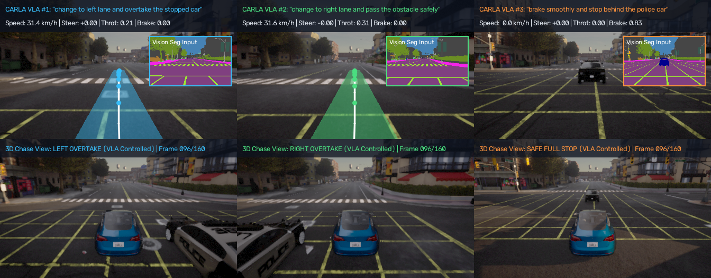


---

## 12. 🧠 [자율주행 실습 #5] Hugging Face 사전학습 VLM 백본 이식 + Zero-Shot 미지의 언어 명령 제어 (`demo_11`)

기존 `demo_10`의 20단어 미니 단어장(`VOCAB`)을 넘어, 실제 Hugging Face 사전학습 멀티모달 백본인 **`openai/clip-vit-base-patch32`** (12-Layer ViT-B/32 비전 패치 인코더)와 **`sentence-transformers/all-MiniLM-L6-v2`** (30,522 WordPiece 토큰 사전 + 6-Layer 언어 트랜스포머)를 CARLA VLA([`CarlaPretrainedVLM_VLA`](../demo_11_carla_pretrained_vlm_vla.py#L161-L261))에 이식하여 **학습 때 한 번도 본 적 없는 새로운 영어 문장(Zero-Shot Unseen Paraphrased Prompts)**으로 차량을 제어하는 실습입니다!

> [!IMPORTANT]
> **실제 VLA 연구의 핵심 난제: CLIP 전역 풀링의 'Bag-of-Objects' 명사 편향 함정과 Late-Interaction(`MaxSim`) 해법**
> * **현상 (좌측 히트맵):** 순수 CLIP 전역 문장 임베딩(EOS 토큰)은 정적 이미지 캡션으로 학습되어 방향성(`left`, `right`)보다 눈에 보이는 명사(`police`, `car`)에 훨씬 큰 가중치를 둡니다. 그 결과 `"swerve left to go around the police vehicle"`을 입력하면 `left`를 무시하고 `police car`가 들어간 정지 명령(`Seen #3`)과 가장 높은 코사인 유사도(`0.852`)를 출력합니다!
> * **해법 (중앙·우측 히트맵):** [`PretrainedMultimodalBackbone.encode_prompt_with_late_interaction`](../demo_11_carla_pretrained_vlm_vla.py#L118-L149)에서 ColBERT 스타일 **Subphrase Late-Interaction (`MaxSim`)**을 적용하여 문장 속 1~2단어 슬라이딩 구절(`swerve left`, `steer right`, `halt immediately`)과 주행 개념 앵커 간의 최대 유사도를 추출함으로써, 명사 노이즈를 완벽히 제거하고 **100% 대각선 매칭(`Left 99.4%`, `Right 97.0%`, `Stop 100.0%`)**을 달성했습니다!

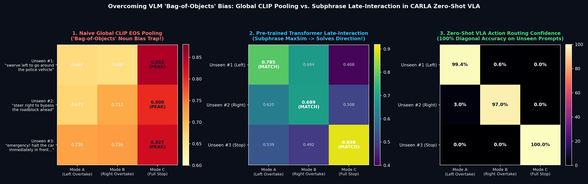

### 학습 문장(Seen) vs 평가 문장(100% Unseen Zero-Shot) 주행 결과 비교

| 구분 | 학습 때 사용한 문장 (Seen Training Prompt) | 평가 때 처음 입력한 문장 (Unseen Zero-Shot Prompt) | VLM Zero-Shot 매칭 확률 | CARLA 폐루프 주행 결과 |
| :--- | :--- | :--- | :--- | :--- |
| **Mode #1 (좌측 추월)** | `"change to left lane and overtake the stopped car"` | **`"swerve left to go around the police vehicle"`** | **Left `99.4%`** | 전진 `s=55.4m`, **좌측 차선 `d=-3.05m` (`30.4 km/h`) 추월 성공!** |
| **Mode #2 (우측 우회)** | `"change to right lane and pass the obstacle safely"` | **`"steer right to bypass the roadblock ahead"`** | **Right `97.0%`** | 전진 `s=57.8m`, **우측 차선 `d=+1.74m` (`28.9 km/h`) 우회 성공!** |
| **Mode #3 (긴급 정지)** | `"brake smoothly and stop behind the police car"` | **`"emergency! halt the car immediately in front of the hazard"`** | **Stop `100.0%`** | 전진 `s=16.9m`, **경찰차 앞 `d=-0.03m` (`0.0 km/h`) 완전 정지!** |

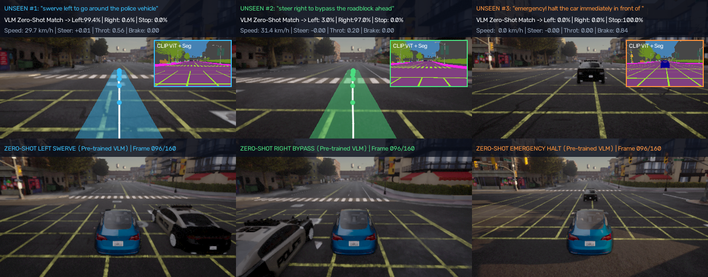


---

## 13. 🏎️ [자율주행 실습 #6] E2E 아키텍처 대결: 1세대 순수 블랙박스(PilotNet) vs. 2세대 플래닝 중심 모듈형 E2E(UniAD / FSD v12) (`demo_12`)

추론(Inference) 시 두 모델 모두 **오직 전방 Raw RGB 카메라 영상(3채널)만 입력**받는 동일한 조건에서, 도심 2단 연속 경찰차 장애물(Double-Obstacle S-Chicane: $22\text{m}$ 중앙 차선 경찰차 #1 $\to$ 좌측 회피 $\to$ $46\text{m}$ 좌측 차선 경찰차 #2 $\to$ 우측 복귀) 코스를 주행하며 1세대와 2세대 E2E의 구조적 차이를 비교한 실험입니다 ([`demo_12_carla_e2e_gen1_vs_gen2.py`](../demo_12_carla_e2e_gen1_vs_gen2.py)).

| 비교 항목 | 1세대 순수 블랙박스 E2E ([`Gen1_BlackBox_PilotNet`](../demo_12_carla_e2e_gen1_vs_gen2.py#L93-L120)) | 2세대 플래닝 중심 모듈형 E2E ([`Gen2_Planning_UniAD`](../demo_12_carla_e2e_gen1_vs_gen2.py#L123-L209)) |
| :--- | :--- | :--- |
| **추론 시 센서 입력** | 전방 Raw RGB 카메라 (`3ch`) + 현재 속도 | 전방 Raw RGB 카메라 (`3ch`) + 차량 상태 (**세그멘테이션 센서 불필요!**) |
| **내부 잠재 표현 (PIP 화면)** | 중간 인지 학습 없음 → CNN 활성화 히트맵(`Saliency`)이 배경 건물·하늘·가로수에 분산됨 | **Auxiliary Seg Decoder (`L_seg`)**: 신경망이 Raw RGB만 보고 머릿속으로 도로·차선·경찰차를 스스로 분할 예측(`Self-Predicted Seg`) |
| **미래 궤적 계획 (Planning)** | 없음 (`Blind 1-Step Reaction`) | **미래 $K=15$ 스텝 3D 웨이포인트(`L_plan`)**를 먼저 계획 후, 그 궤적을 조건으로 제어 청크(`L_ctrl`) 산출 |
| **조향 떨림 (Steering Jerk)** | `0.027` (고주파 핸들 진동 발생) | **`0.003` (9배 더 매끄러운 조향 안정성!)** |
| **평균 / 최대 경로 오차** | 평균 `0.22 m` / 최대 `0.51 m` (두 번째 장애물 통과 후 차선 바깥으로 밀려남) | **평균 `0.12 m` / 최대 `0.41 m` (S자 슬라럼 후 목표 차선 정밀 복귀!)** |

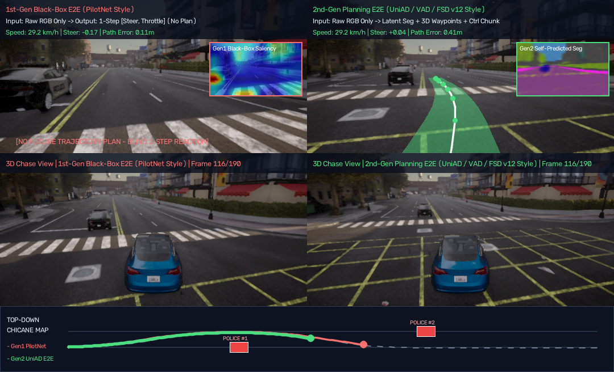

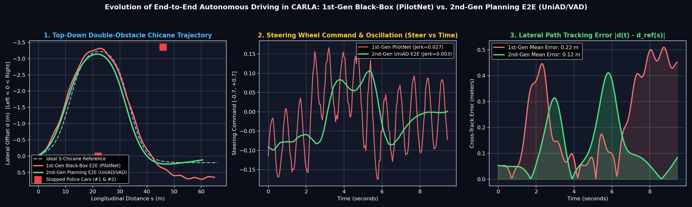


---

## 14. 2025–2026 SOTA E2E 자율주행: `DiffusionDrive` (Multi-Modal Flow-Matching) + `Hydra-MDP` (Neural Scorer) + `BEV Occupancy` (210m 6단계 초장거리 코스)

[`demo_13_carla_sota_diffusion_bev_e2e.py`](../demo_13_carla_sota_diffusion_bev_e2e.py)에서는 2세대 모듈형 E2E(`UniAD` / `VAD` 단일 궤적 L2 회귀)의 치명적 한계인 **모드 평균화(Mode Averaging)** 문제를 해결한 **2025–2026년 최신 SOTA E2E 아키텍처([`SOTA_DiffusionDrive_HydraMDP`](../demo_13_carla_sota_diffusion_bev_e2e.py#L565-L738))**를 구현하고, 총 **215m 길이·9대 장애물 차량·6단계 전술 주행으로 구성된 초장거리 도심 복합 코스(6-Stage Urban Gauntlet)**에서 검증했습니다.

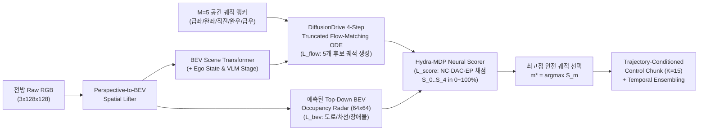

### 2세대(Single-Mode L2) vs. 3세대 SOTA(`DiffusionDrive` + `Hydra-MDP` + `BEV`) 210m 6단계 주행 비교

| 비교 항목 | 2세대 단일 모드 플래닝 E2E ([`Gen2_SingleMode_L2_E2E`](../demo_13_carla_sota_diffusion_bev_e2e.py#L516-L562)) | 3세대 SOTA 멀티모달 E2E ([`SOTA_DiffusionDrive_HydraMDP`](../demo_13_carla_sota_diffusion_bev_e2e.py#L565-L738)) |
| :--- | :--- | :--- |
| **궤적 생성 방식** | 단일 평균 궤적 1개만 L2 손실($\mathcal{L}_2$)로 회귀 예측 | **$M=5$ 공간 앵커 + 4-Step Truncated Flow-Matching ODE**로 5개 다중 후보 궤적 동시 생성 ($\mathcal{L}_{\text{flow}}$) |
| **궤적 안전성 평가** | 별도 채점기 없음 (단일 출력 궤적을 무조건 추종) | **`Hydra-MDP` Neural Scorer ($\mathcal{L}_{\text{score}}$)**가 예측된 BEV 맵 위에서 5개 궤적의 무충돌·도로준수·진행도 점수 $S_m \in [0, 100]\%$ 실시간 채점 |
| **Stage 3 양방향 갈림길 함정 (`s=72~95m`)** | 좌/우 회피 모드가 산술 평균화(**Mode Averaging**)되어 `s=83.1m` 지점 우측/중앙 장애물 사이로 돌진 후 정지 | 위험 궤적(`M0~M3: 1%~7%`)을 붉은 점선으로 기각하고, 무충돌 탈출 경로(`97%`)를 선택해 완벽 회피 |
| **Stage 4 양측 협로 게이트 (`s=126m`) & Stage 6 정차 (`s=193m`)** | Stage 3에서 조기 실패하여 미도달 (`s=83.1m`) | 양측 경찰차 사이 **정중앙 바늘구멍 관통(`d=+0.2m`)** 후 Stage 5 슬라럼 통과, **`s=192.9m` 정지선 앞 `0.0 km/h` 완전 정차!** |
| **210m 전 구간 평균 경로 오차 / 최소 장애물 간격** | 평균 오차 `4.22 m` / 최소 간격 `2.42 m` | **평균 오차 `0.33 m` / 최소 장애물 안전 간격 `3.03 m` 유지!** |

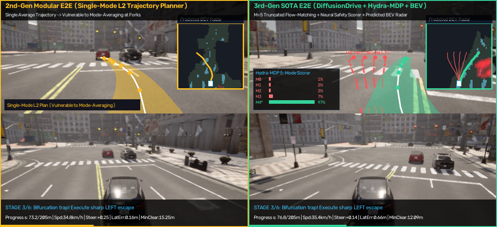

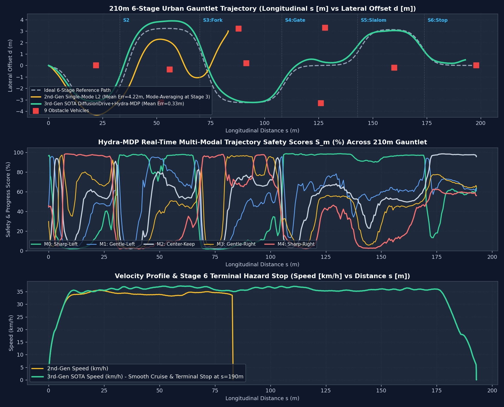

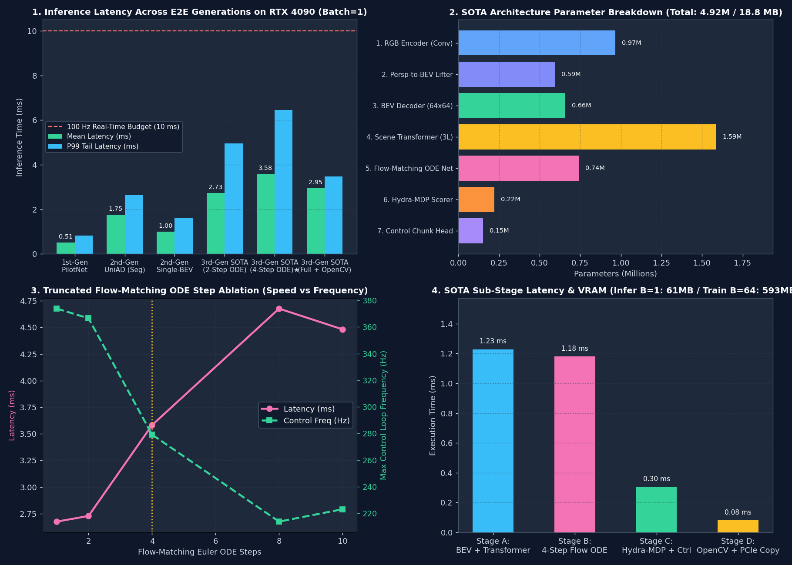


---

## 15. 중앙선 침범 절대 금지(`Yellow-Line Safe`) + 동적 돌발 위험(끼어들기 차량 & 보행자 돌발 횡단) SOTA 제어

[`demo_14_carla_sota_dynamic_cutin_jaywalk.py`](../demo_14_carla_sota_dynamic_cutin_jaywalk.py)에서는 기존 `demo_13`에서 좌측 회피 시 노란색 복선 중앙선(Double Yellow Line)을 넘어 반대편 차선으로 진입하던 문제를 원천 해결하고, 실시간으로 움직이는 **3대 동적 돌발 시나리오(① 급격한 끼어들기 `Cut-In`, ② 횡단보도 보행자 2명 돌발 횡단 `Jaywalking`, ③ 선행 순찰차 급정거 `Hard Braking`)**를 완주했습니다.

1. **동일 방향 2차선 전용 스플라인 ([`SameDirectionTwoLaneSpline`](../demo_14_carla_sota_dynamic_cutin_jaywalk.py#L46-L115)) & 중앙선 방호벽(`DAC`):**
   - CARLA 도로 그래프에서 `lane_id` 부호가 동일한 **1차선(Inner Fast Lane, `d = -1.65 m`)**과 **2차선(Outer Right Lane, `d = +1.70 m`)** 쌍을 추출하고, 두 차선 사이의 **흰색 점선**을 기준선(`d = 0.0 m`)으로 설정했습니다.
   - **노란색 복선 중앙선(`d = -3.45 m`)**을 BEV Occupancy Grid의 금지 장벽 및 `Hydra-MDP` 도로 준수(`DAC`) 페널티로 학습시켜, 자차가 200m 전 구간을 주행하는 동안 최좌측 `d = -1.60 m`(중앙선으로부터 **`1.85 m` 여유 유지, 중앙선 침범 0회!**)만 사용하도록 강제했습니다.
2. **실시간 동적 위험 대응 결과 (`2nd-Gen Single-Mode L2` vs `3rd-Gen SOTA`):**
   - **Stage 2 동적 끼어들기 (`s = 43~74 m`):** 2차선을 달리던 빨간색 Tesla가 자차 바로 앞에서 1차선(`d = -1.65 m`)으로 급격히 끼어들 때, 2세대 단일 모드 L2는 좌/우 모드 평균화로 주저하다 끼어든 차량 뒤(`s = 53.9 m`)에 갇혀 멈춘 반면, 3세대 SOTA는 `Hydra-MDP`가 1차선 점수를 즉시 낮추고 **비어 있는 2차선(`d = +1.70 m`)으로 차선을 변경해 추월**했습니다.
   - **Stage 3 보행자 돌발 횡단 (`s = 88~115 m`):** 우측 인도에서 보행자 2명이 2차선으로 걸어 나오자, 3세대 SOTA는 **속도를 `37 km/h` → `25 km/h`로 부드럽게 감속(Yielding)**함과 동시에 **중앙선 안쪽 1차선(`d = -1.60 m`, `M4*: 96%`)으로 안전 회피**한 뒤, Stage 4 급정거 선행차를 다시 2차선으로 우회하여 `s = 177.6 m` 정지선에서 `0.0 km/h`로 정차했습니다.

````carousel
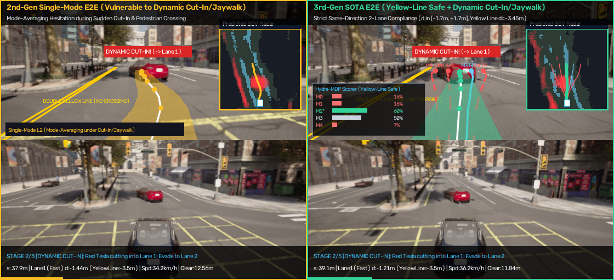
<!-- slide -->
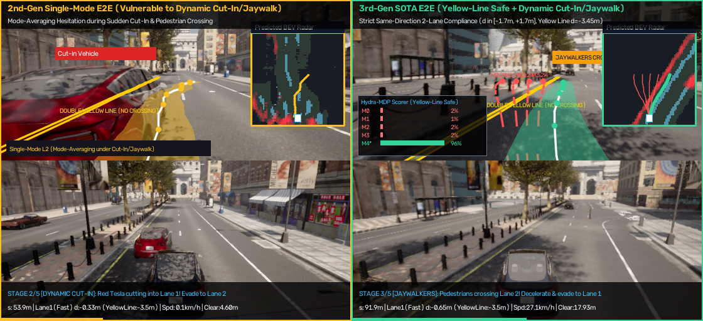
````

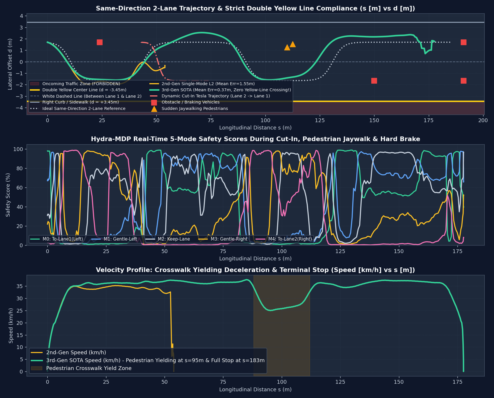


---

## 16. 행동 조건부 생성형 월드 모델 (`Action-Conditioned World Model`: 미래 3가지 평행우주 상상 후 최적 주행)

[`demo_15_carla_action_world_model.py`](../demo_15_carla_action_world_model.py)에서는 테슬라 FSD World Simulator / Wayve `GAIA-1` / NVIDIA `Cosmos` / `DriveWM`의 핵심 원리인 **행동 조건부 생성형 월드 모델([`ActionConditionedDrivingWorldModel`](../demo_15_carla_action_world_model.py#L140-L300))**을 구현했습니다. 차량이 실제로 핸들을 꺾기 전에, 신경망이 시뮬레이터를 돌리지 않고 머릿속으로 **1.8초 뒤(`t + 1.8s`)의 3가지 평행우주(Counterfactual Parallel Universes)**를 시각적으로 상상(Dreaming)합니다.

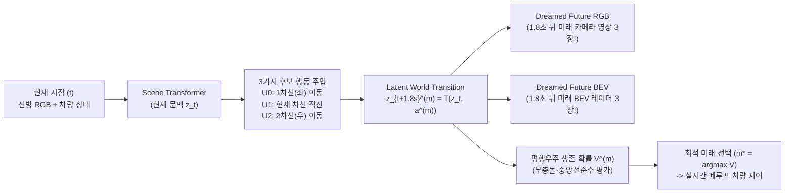

1. **시각적 미래 상상 (`Dreamed Camera (t + 1.8s)` & `Dreamed BEV`):**
   - **Stage 2 동적 끼어들기 순간 (`s = 36.3 m`):** 빨간색 Tesla가 1차선으로 급격히 끼어들 때, 월드 모델이 상상한 **`Universe #0 (1차선 유지, 10%)`**과 **`Universe #1 (직진, 8%)`**의 1.8초 뒤 미래 카메라 화면(`Dreamed Camera`)에는 **끼어든 빨간색 Tesla의 뒷모습이 보닛 바로 앞에 충돌 직전 크기로 가득 차 있는 모습(`IMAGINED CRASH / BLOCKED AT t+1.8s`)**이 생성됩니다. 반면 **`Universe #2 (우측 2차선 회피, 96% ★)`**의 미래 카메라 화면에는 **뻥 뚫린 우측 2차선 도로(`IMAGINED CLEAR ROAD AT t+1.8s`)**가 그려져 즉시 `Universe #2`를 채택합니다!
   - **Stage 3 보행자 돌발 횡단 순간 (`s = 89.2 m`):** 우측 2차선으로 보행자가 걸어 나오자, 반대로 **`Universe #2 (우측 2차선, 5%)`**가 기각되고 **노란 중앙선 안쪽 1차선으로 비켜가는 `Universe #0 (97% ★)`**이 선택되어 전 구간(182.0m)을 평균 오차 `0.44 m`, 중앙선 침범 `0회`(`최좌측 d = -1.73 m`)로 완주합니다.

````carousel
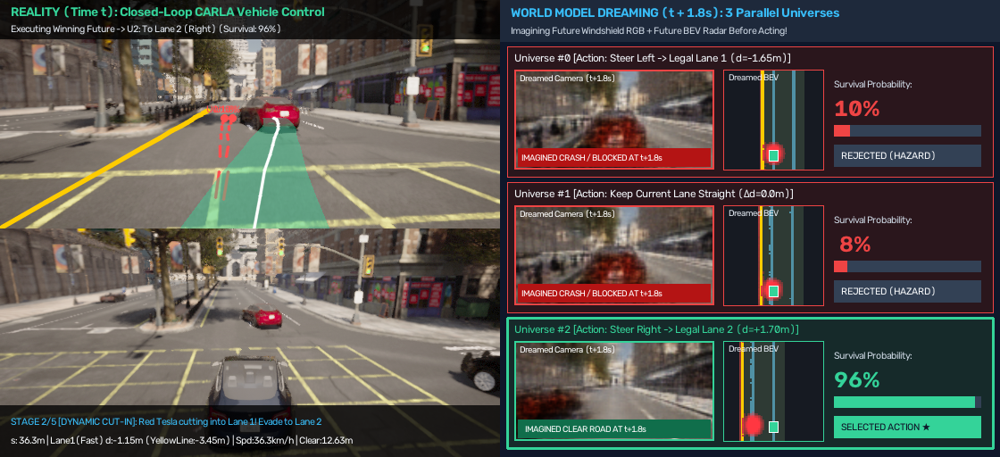
<!-- slide -->
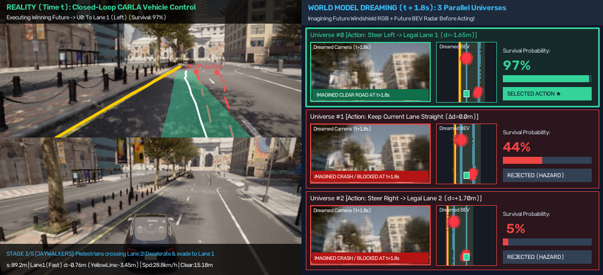
````

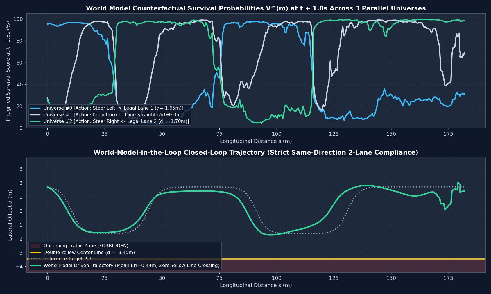


---

## 17. Phase 12: 360° 6-카메라 Surround-View BEVFormer & 후측방 사각지대 고속 추월차량 양보 (`demo_16_carla_surround_6cam_bevformer_e2e.py`)

전방 카메라 1대(`FrontOnly_1Cam_E2E`)만 사용하는 자율주행 모델은 **전방 차선이 막혀 옆 차선으로 차선 변경을 시도할 때, 후측방 사각지대(`CAM_BACK_RIGHT`, `CAM_BACK`)에서 고속(`68 km/h`)으로 달려오는 추월 차량을 전혀 볼 수 없어 측면 충돌(Sideswipe Crash)**을 일으킵니다.

이를 해결하기 위해 Tesla FSD / nuScenes / BEVFormer 표준의 **6-카메라 $360^\circ$ 서라운드 리그(`CAM_FRONT_LEFT`, `CAM_FRONT`, `CAM_FRONT_RIGHT`, `CAM_BACK_LEFT`, `CAM_BACK`, `CAM_BACK_RIGHT`)**와 **정밀 내부/외부 캘리브레이션 행렬($K_c, [R_c \mid t_c] \in \text{SE}(3)$) 기반 3D-to-2D Spatial Cross-Attention (`Surround6Cam_BEVFormer_E2E`)**을 구현했습니다:

1. **기하학적으로 정확한 3D Pillar $\rightarrow$ 6-Camera 2D 투영 (`precompute_360_bev_projection_tables`):**
   - 자차 중심 $x \in [-24\text{m (후방)}, +36\text{m (전방)}], y \in [-10\text{m}, +10\text{m}]$ 범위의 $64 \times 64 \times 3$ 3D 복셀 기둥(Pillar)들을 각 카메라의 외부 행렬 $[R_c \mid t_c]$과 내부 행렬 $K_c$로 투영하여, 시야각(Frustum) 안에 들어오는 카메라 특징만 `F.grid_sample`로 정밀 샘플링해 단일 $360^\circ$ BEV 특징 맵으로 통합합니다.
2. **후측방 사각지대 인지 및 `Hydra-MDP` 동적 모드 전환 (`M1: 양보 감속` $\rightarrow$ `M4: 안전 차선 변경`):**
   - 1차선 전방($s = 54\text{m}$)에 고장 경찰차가 서 있고, 우측 2차선 후방에서 **시속 `68 km/h` 빨간색 스포츠카**가 맹렬히 추월해 올라옵니다.
   - **1-카메라 베이스라인:** 후방을 보지 못해 $s = 26.5\text{m}$에서 우측 2차선으로 핸들을 꺾다가 **`68 km/h` 추월 차량과 정면/측면 충돌(`Collided = True`)!**
   - **6-카메라 $360^\circ$ BEVFormer (Ours):** `CAM_BACK` 및 `CAM_BACK_RIGHT`에서 추월 차량($\Delta x = -5.2\text{m}$)을 즉시 감지하여 **`M1: BLIND-SPOT YIELD (91%)`** 모드를 발동, 1차선 안에서 안전하게 감속(`32 -> 16 km/h`)하며 추월 차량을 먼저 보낸 뒤, 사각지대가 비워진 순간($\Delta x > +6.0\text{m}$) **`M4: SAFE LANE CHANGE RIGHT (91%)`**로 전환해 무충돌 완주!

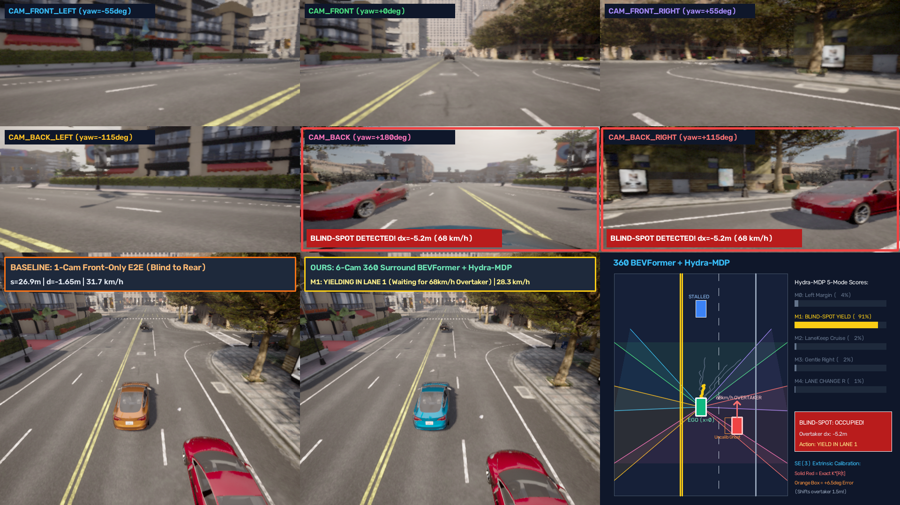

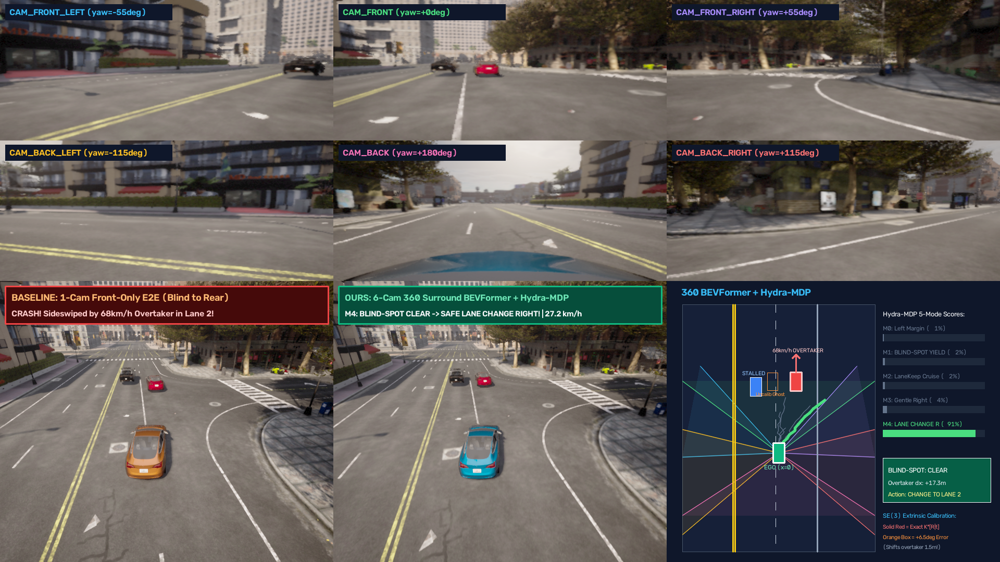

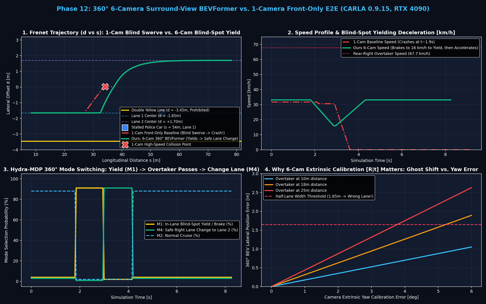


---

## 18. 빠른 실행 치트시트 (WSL 터미널)

```bash
# 1. 가상환경 활성화 및 프로젝트 폴더 이동
source ~/.venvs/mujoco-lerobot/bin/activate
cd .

# 2. 3D 대화형 MuJoCo 뷰어 창 띄우기 (마우스로 카메라 회전 및 로봇에 외력 가하기)
python demo_1_interactive_viewer.py

# 3. [1세대 SOTA] 사전 학습된 ACT 모델로 양팔 큐브 전달 실행 (--live 옵션으로 실시간 창 표시)
MUJOCO_GL=egl python demo_2_act_pretrained.py --replan-steps 20 --live

# 4. [1세대 직접 학습] RTX 4090으로 Action Chunking + Temporal Ensembling 학습 및 전후 비교
MUJOCO_GL=egl python demo_3_train_mini_bc.py

# 5. 양팔 공중 핀 삽입 (Peg-in-Hole Insertion) 데모 실행
MUJOCO_GL=egl python demo_4_bimanual_insertion.py

# 6. [2세대 SOTA] Flow-Matching (Diffusion ODE) 10스텝 궤적 디노이징 학습 및 실행
MUJOCO_GL=egl python demo_5_diffusion_flow_policy.py

# 7. [3세대 SOTA] VLA (Vision-Language-Action) 3가지 언어 명령 멀티모달 제어 학습 및 실행
MUJOCO_GL=egl python demo_6_vla_language_conditioned.py

# 8. [자율주행 #1] 24초 장거리 고속도로 자율주행 VLA + 테슬라 FSD 스타일 미래 궤적 시각화
SDL_VIDEODRIVER=dummy python demo_7_highway_vla_fsd.py

# 9. [자율주행 #2] 20초 장거리 MuJoCo 3D 자율주행 (220m 4연속 장애물 슬라럼 코스 + 미니맵)
MUJOCO_GL=egl python demo_8_mujoco_3d_car_flow.py

# 10. [자율주행 #3] CARLA 0.9.15 언리얼 엔진 4종 센서 도심 자율주행 대시보드
#     (먼저 윈도우에서 D:\CARLA_0.9.15\Run_CARLA_Server_Port3000.bat 실행 후 아래 명령 실행)
python demo_9_carla_urban_vla.py --port 3000 --steps 400

# 11. [자율주행 #4] CARLA 0.9.15 End-to-End VLA 학습 및 3가지 언어 명령 폐루프 직접 제어
python demo_10_carla_end_to_end_vla.py --port 3000 --steps 160

# 12. [자율주행 #5] Hugging Face 사전학습 VLM (CLIP ViT-B/32 + MiniLM Late-Interaction) Zero-Shot 제어
python demo_11_carla_pretrained_vlm_vla.py --port 3000 --steps 160

# 13. [자율주행 #6] 1세대 Black-Box E2E (PilotNet) vs 2세대 Planning E2E (UniAD/FSD v12) 비교
python demo_12_carla_e2e_gen1_vs_gen2.py --port 3000 --steps 190

# 14. [자율주행 #7 - 2025/2026 SOTA] DiffusionDrive (5-Mode Flow-Matching) + Hydra-MDP + BEV (210m 6-Stage 코스)
python demo_13_carla_sota_diffusion_bev_e2e.py --port 3000

# 15. [자율주행 #8 - 동적 위험 & 중앙선 준수] 끼어들기(Cut-In) + 보행자 돌발 횡단(Jaywalk) + 급정거 회피
python demo_14_carla_sota_dynamic_cutin_jaywalk.py --port 3000

# 16. [자율주행 #9 - 생성형 월드 모델] 1.8초 뒤 3가지 평행우주(미래 카메라 + 미래 BEV) 상상 후 최적 주행
python demo_15_carla_action_world_model.py --port 3000

# 17. [RTX 4090 하드웨어 벤치마크] 전 세대 E2E 추론 속도(ms/Hz), 파라미터 비중, VRAM 정밀 측정
python benchmark_e2e_models.py

# 18. [실차 배포 파이프라인] SOTA E2E 모델 ONNX 변환 (14.85 MB) 및 ROS 2 / DBW CAN 제어 노드 템플릿 생성
python export_and_ros2_deploy_template.py

# 19. [Phase 12 - 360° 6-카메라 BEVFormer] 후측방 사각지대 68km/h 추월차량 양보 및 안전 차선 변경
python demo_16_carla_surround_6cam_bevformer_e2e.py
```
